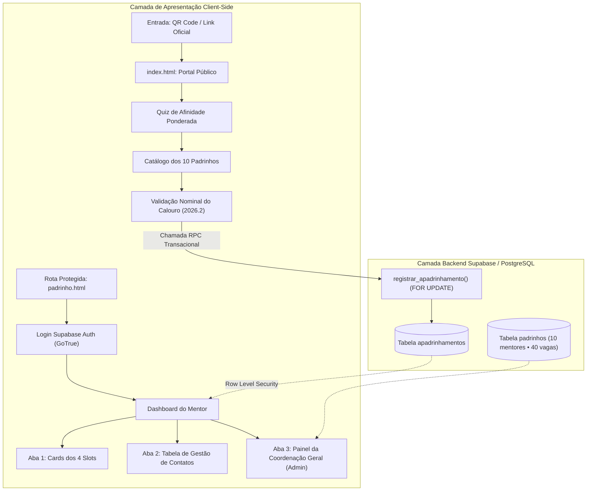

# Sistema de Apadrinhamento Acadêmico • Bacharelado em Administração (UFAPE)
### Plataforma Web de Integração, Acolhimento e Compatibilidade de Ingressantes 2026.2

[](LICENSE)
[-success.svg)](scripts/test_rules.py)
[](https://ufape.edu.br)
[](https://sistema-apadrinhamento-ufape-adm.vercel.app)
[](docs/adr/)

---

## 1. Identificação Acadêmica e Registro de Autoria

* **Instituição de Ensino Superior:** Universidade Federal do Agreste de Pernambuco (UFAPE)
* **Idealização e Concepção do Projeto:** **Heloísa Pereira Barreto**
  * *Vínculo Acadêmico:* Discente ingressante em 2026.1 (2º semestre) do Bacharelado em Administração (UFAPE) e Coordenadora Discente do Programa
* **Engenharia de Software e Responsabilidade Técnica:** **Kauã Vinicius dos Santos Barbosa**
  * *Vínculo Acadêmico:* Discente ingressante em 2025.1 do Bacharelado em Ciência da Computação (BCC / UFAPE)
  * *E-mail Institucional:* `kaua.vinicius@ufape.edu.br`
  * *E-mail Profissional:* `kauavdsb.jobs@gmail.com`
  * *Perfil GitHub:* [github.com/KauaVDSB](https://github.com/KauaVDSB)
* **Curso Beneficiário:** Bacharelado em Administração (UFAPE)
* **Finalidade Institucional:** Projeto de Extensão Universitária, Inovação Tecnológica e Desenvolvimento de Software Voluntário para Convalidação de **Atividades Curriculares Complementares (ACC)**
* **Semestre Letivo de Execução:** 2026.2 (Lançamento Oficial em Outubro de 2026)

---

## 2. Contextualização e Justificativa Institucional

O ingresso na universidade pública impõe desafios sociais, pedagógicos e emocionais. Sem programas estruturados de acolhimento discente, elevam-se os riscos de isolamento e evasão precoce nos períodos iniciais. O **Programa de Apadrinhamento Acadêmico de Administração da UFAPE** estabelece uma rede colaborativa onde discentes veteranos (mentores do 2º período em diante) orientam e integram os novos estudantes no semestre letivo 2026.2.

O curso de Bacharelado em Administração da UFAPE oferta **40 vagas reais por semestre**. Contudo, nos processos seletivos do SISU e editais de chamadas da instituição (1 chamada regular + 9 listas de espera / remanejamentos), foram convocados **159 candidatos**, um contingente elevado resultante de desistências, remanejamentos de curso e matrículas indeferidas. Para assegurar que qualquer calouro legitimamente matriculado entre as 40 vagas consiga se conectar ao seu mentor sem atritos, a base nominal do sistema engloba o universo integral de convocados, higienizada e auditada contra veteranos de semestres anteriores.

A plataforma substitui controles manuais e planilhas descentralizadas por uma aplicação web robusta, pautada nas seguintes diretrizes:

1. **Validação Nominal Confiável:** Checagem em tempo real contra a listagem de convocados (159 candidatos aptos a concorrer às 40 vagas efetivas), com expurgo auditado dos 35 veteranos de 2026.1 e mecanismo de contingência temporal;
2. **Quiz de Afinidade Ponderada:** Motor heurístico de compatibilidade que conecta calouros a veteranos de perfil acadêmico e comportamental convergente;
3. **Segurança da Informação e LGPD:** Arquitetura *Defense-in-Depth* com isolamento multi-inquilino via *Row Level Security* (RLS), impedindo visualização indevida de dados de contato;
4. **Governança Estrita de Vagas:** Parametrização matemática de cotas (10 mentores oficiais com exatamente 4 vagas cada, totalizando com precisão as 40 vagas reais do curso), protegidas contra condições de corrida (*race conditions*);
5. **Divulgação Institucional via QR Code:** Experiência 100% *Mobile-First*, acessível instantaneamente na leitura de cartazes e murais físicos no campus da UFAPE.

---

## 3. Metodologias de Engenharia de Software e Práticas Profissionais

O projeto foi construído empregando padrões consolidados da Engenharia de Software moderna, garantindo legibilidade, manutenibilidade, testabilidade e alta escalabilidade:

### 3.1. Princípios SOLID & Clean Architecture
* **Single Responsibility Principle (SRP):** Cada módulo da aplicação possui uma responsabilidade única e bem demarcada:
  * `js/data.js`: Repositório imutável e estruturado dos mentores oficiais, pesos de compatibilidade e regras de negócio;
  * `js/main.js`: Controlador do fluxo público (ingestão do quiz, motor de compatibilidade e orquestração da interface);
  * `js/padrinho-app.js`: Controlador de autenticação, ciclo de sessão GoTrue e gestão de afilhados do portal restrito;
  * `scripts/ingest_data.py`: Módulo extrator e higienizador dos editais e atas da UFAPE.
* **Open/Closed Principle (OCP):** A estrutura de cálculo de afinidade e filtros do mural é extensível para novos critérios sem necessidade de alterar a lógica interna do motor de compatibilidade;
* **Interface Segregation & Loose Coupling:** A camada de comunicação com o Supabase é desacoplada da renderização de interface através de adaptadores assíncronos.

### 3.2. Segurança em Profundidade (Defense-in-Depth) & LGPD
* **Row Level Security (RLS) Estrita no PostgreSQL:** As tabelas do banco de dados são blindadas no nível de linha do PostgreSQL. Mentores autenticados só conseguem ler dados de calouros vinculados ao seu próprio `user_id` (`padrinho_id = auth.uid()`);
* **Prevenção de Recursão Infinita em Políticas:** Implementação da função utilitária `public.is_admin()` com `SECURITY DEFINER` e `STABLE`, contornando potenciais loops de consulta cíclica entre papéis administrativos;
* **Sanitização Contextual contra Cross-Site Scripting (XSS):** Todo input fornecido por usuários externos (nomes, redes sociais, justificativas) é sanitizado via função `escapeHtml()` antes de qualquer injeção no DOM;
* **Privacidade e Suspense Pré-Cerimônia (ADR-005):** Telefones e contatos de mentores permanecem anônimos e protegidos no mural público até a Cerimônia Presencial de Acolhimento (14/10/2026).

### 3.3. Concorrência e Prevenção de Race Conditions
* **Transações Atômicas com Bloqueio Pessimista (`FOR UPDATE`):** No pico de submissões simultâneas via QR Code, o sistema invoca a Stored Procedure transacional `registrar_apadrinhamento`. O registro do mentor é bloqueado temporariamente no PostgreSQL (`SELECT limite_vagas FROM padrinhos WHERE id = ... FOR UPDATE`), garantindo consistência estrita (*ACID*) e impedindo sobre-alocação além do limite de 4 vagas (ADR-003).

### 3.4. Engenharia de Qualidade, TDD e Especificação BDD/Gherkin
* **Desenvolvimento Orientado a Testes (TDD):** A suíte automatizada `scripts/test_rules.py` foi escrita para balizar o desenvolvimento dos pipelines de dados e cotas;
* **Especificações Formais BDD (Behavior-Driven Development):** Contratos de negócio descritos formalmente em sintaxe Gherkin (`Dado / Quando / Então`), garantindo validação de cenários de sucesso, esgotamento de vagas e restrições de privacidade (ADR-009);
* **100% de Sucesso e Cobertura nos Testes Críticos:** Auditoria nominal do universo de 159 convocados em listas de espera para o preenchimento das 40 vagas reais do curso, purga matemática de 35 veteranos de 2026.1 e validação nominal com 0 falhas registradas.

### 3.5. Auditoria de Performance e Compatibilidade Cross-Browser
* **Abordagem Vanilla Ultra-Leve:** Zero dependência de frameworks monolíticos (React, Angular ou Vue). A aplicação carrega com menos de 100 KB de ativos essenciais;
* **Métricas Core Web Vitals:** Tempo de carregamento (*First Contentful Paint*) inferior a 800ms em redes 4G/3G móveis;
* **Compatibilidade Multiplataforma:** Testado e auditado em três grandes famílias de renderização:
  * **Chromium:** Google Chrome, Microsoft Edge, Brave (Android, Windows, Linux);
  * **WebKit:** Apple Safari (iOS 15+, iPadOS e macOS);
  * **Gecko:** Mozilla Firefox (Desktop e Mobile).

### 3.6. Metodologia Ágil (Sprints & Git Flow)
* **Desenvolvimento Iterativo:** 7 Sprints e Micro-Sprints planejadas e executadas com entregas atômicas e revisões formais;
* **Padrão Conventional Commits:** Histórico de versionamento semântico (`feat:`, `fix:`, `style:`, `docs:`, `refactor:`);
* **Integração e Entrega Contínuas (CI/CD):** Deploy automatizado com suporte a *Clean URLs* hospedado na Vercel a cada integração na branch `main`.

---

## 4. Registro de Atividades Técnicas e Carga Horária (ACC)

Tabela detalhada de esforço computacional e dedicação técnica para homologação de horas em **Atividades Curriculares Complementares (ACC)** junto à Coordenação do Curso de Ciência da Computação (BCC / UFAPE):

| Módulo / Atividade | Descrição Técnica da Atividade Desenvolvida | Carga Horária |
| :--- | :--- | :---: |
| **I. Engenharia de Requisitos e Modelagem** | Elicitação de requisitos acadêmicos junto à liderança de Administração, modelagem de dados relacional PostgreSQL, definição de regras de negócio e governança RBAC. | **8h** |
| **II. UI/UX Design e Prototipagem Mobile-First** | Arquitetura de informação, criação de componentes com a paleta institucional (#0E2A47, #1E4C7C, #C9A227), design de cards de acolhimento, monogramas proporcionais e testes de acessibilidade. | **10h** |
| **III. Desenvolvimento Frontend (Core e Quiz)** | Implementação em padrões web nativos (HTML5 semântico, CSS3 e JavaScript ES6+ modular), motor heurístico de afinidade, validação dinâmica de formulários e Clean URLs. | **14h** |
| **IV. Engenharia Backend e Segurança (Supabase/PostgreSQL)** | Estruturação de DDL, implementação de *Row Level Security* (RLS), criação de RPC transacional com bloqueio `FOR UPDATE` e configuração de autenticação GoTrue. | **10h** |
| **V. Ingestão de Dados e Pipeline de Auditoria** | Desenvolvimento de scripts em Python (`pdfplumber`) para extração e saneamento dos 10 editais da UFAPE (159 convocados vs 40 vagas), normalização Unicode NFD e purga de 35 veteranos de 2026.1. | **8h** |
| **VI. Painel de Gestão (Portal do Mentor & Coordenação)** | Desenvolvimento da interface restrita `/padrinho/`, segmented tabs, visualização em cards e tabelas, modais com viewport overlay, troca de senha e visão analítica para coordenação. | **8h** |
| **VII. Homologação, Testes Automatizados e CI/CD** | Implementação da suíte `scripts/test_rules.py` (5/5 testes), auditoria cross-browser, otimização de ativos WebP/PNG e configuração do pipeline de deploy contínuo na Vercel. | **6h** |
| **VIII. Participação e Apoio no Evento Presencial** | Suporte técnico presencial, orientação aos calouros e validação operacional durante a Cerimônia de Apadrinhamento na Quadra da UFAPE (14/10/2026). | **4h** |
| **TOTAL GERAL REGISTRADO** | **Carga horária técnica total para comprovação e convalidação de ACC** | **68h** |

---

## 5. Arquitetura da Solução e Estrutura de Rotas



### 5.1. Mapeamento de Rotas
* `/` (`index.html`): Portal público contendo apresentação do programa, quiz de afinidade, visualização das cotas dos 10 mentores em tempo real, formulário de identificação e seleção;
* `/padrinho` (`padrinho.html`): Portal exclusivo dos mentores veteranos, com autenticação individual, gerenciamento dos 4 afilhados em cards/tabela, links diretos para WhatsApp e visão macro da coordenação;
* `/404.html`: Tratamento amigável e institucional para rotas inexistentes.

---

## 6. Suíte de Testes Automatizados

A integridade do sistema é verificada através da suíte `scripts/test_rules.py`, executável em ambiente local ou na esteira de integração:

```bash
python3 scripts/test_rules.py
```

### Resultados da Auditoria:
* **[TESTE 1] Verificação de Cotas dos Mentores:** 10 mentores ativos com 4 vagas cada (Total: 40 vagas reais no programa, casando com as 40 vagas da turma) — **[OK]**;
* **[TESTE 2] Auditoria da Purga de Veteranos de 2026.1:** 35 veteranos da Ata Oficial expurgados das listas de 2026.2 sem nenhum falso positivo — **[OK]**;
* **[TESTE 3] Unicidade Cadastral de 2026.2:** Base de 159 convocados em listas de espera auditada com unicidade nominal absoluta para acolher as 40 vagas da turma — **[OK]**;
* **[TESTE 4] Simulação de Validação no Frontend:** Tratamento de acentuação, múltiplos espaços e variações ortográficas — **[OK]**;
* **[TESTE 5] Auditoria de Segurança UX e Contratos:** Conformidade com LGPD, modais acessíveis e isolamento de contatos — **[OK]**.

---

## 7. Como Executar o Projeto Localmente

### Pré-requisitos
* Python 3.10+ (para servidor local e suíte de testes);
* Navegador moderno (Chrome, Firefox, Safari ou Edge).

### Passo a Passo
1. Clone o repositório oficial:
```bash
git clone https://github.com/KauaVDSB/sistema-apadrinhamento-ufape-adm.git
cd sistema-apadrinhamento-ufape-adm
```

2. Inicie o servidor de desenvolvimento local:
```bash
python3 dev-server.py
```

3. Acesse a aplicação no navegador:
* Portal do Calouro: [http://localhost:3000](http://localhost:3000)
* Portal do Padrinho: [http://localhost:3000/padrinho](http://localhost:3000/padrinho)

---

## 8. Direitos Autorais e Licença

Este software é licenciado sob os termos da **MIT License** por **Kauã Vinicius dos Santos Barbosa**, com cessão de uso integral, permanente e irrestrita à Universidade Federal do Agreste de Pernambuco (UFAPE).

Consulte o arquivo [LICENSE](LICENSE) para termos integrais.
